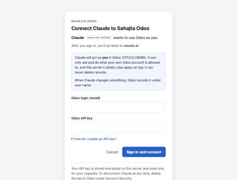

# Deploying the company connector

Goal: an HTTPS address such as `https://odoo-mcp.sahajta.ai/mcp` that you add to Claude once for the whole
organisation; each employee then connects with their own Odoo API key.

## 1. What you need

* A small Linux server (1 vCPU / 1 GB RAM is plenty) with a **public IPv4 address** (Claude's connector
  traffic is IPv4-only) and Docker installed. Any provider works: Hetzner, DigitalOcean, AWS Lightsail, a GCP
  e2-small, an office server with a public IP.
* A DNS name pointing at it (an `A` record), e.g. `odoo-mcp.sahajta.ai`.
* Odoo on the **Custom** plan (external API access), see [ODOO_SETUP.md](ODOO_SETUP.md).

> Platforms like Railway, Render or Fly.io also work: deploy the `Dockerfile`, attach a **persistent volume at
> `/data`**, set `MCP_TRUST_PROXY_HEADERS=true`, and use their HTTPS URL as `MCP_PUBLIC_URL`. `/data` holds only
> the sign-in database (no business data); if it's lost, people simply reconnect. Run **one** instance: sign-ins
> live in SQLite, while single-use approval tokens and rate limits live in memory, so several replicas would
> weaken those protections.

## 2. Configure

```bash
git clone <this repo> sahajta-odoo-mcp && cd sahajta-odoo-mcp
cp .env.example .env
python3 -c "import secrets; print(secrets.token_urlsafe(48))"   # paste the output as MCP_SECRET
```

Edit `.env`:

| Setting | Value |
|---|---|
| `ODOO_URL` | `https://<yours>.odoo.com` |
| `ODOO_DB` | your database name (usually the sub-domain) |
| `MCP_PUBLIC_URL` | `https://odoo-mcp.sahajta.ai` (no `/mcp`, no trailing slash) |
| `MCP_SECRET` | the random value from above. Keep it secret; changing it signs everyone out |
| `MCP_ALLOWED_LOGIN_DOMAINS` | `sahajta.ai` so only company logins can connect |
| `MCP_ACCESS_MODE` | start with `read_only`; switch to `read_write` once you're comfortable |
| `MCP_TRUST_PROXY_HEADERS` | `true` with the included Caddy proxy |

Leave `ODOO_LOGIN` / `ODOO_API_KEY` empty: in company mode nobody's key is stored in the config.

## 3. Run

```bash
DOMAIN=odoo-mcp.sahajta.ai docker compose up -d --build
```

Caddy gets a Let's Encrypt certificate automatically (ports 80 and 443 must be open).

Check it:

```bash
curl https://odoo-mcp.sahajta.ai/healthz
```

That should return `{"status":"ok",...}`. Then:

```bash
curl -i -X POST https://odoo-mcp.sahajta.ai/mcp
```

That should return `401` with a `WWW-Authenticate: Bearer ... resource_metadata=...` header.

## 4. Add it to Claude

**Team / Enterprise** (an Owner does this once):

1. *Organization settings → Connectors → Add → Custom → Web*.
2. Name: `Sahajta Odoo`. URL: `https://odoo-mcp.sahajta.ai/mcp`. Leave the OAuth client ID/secret empty; Claude
   registers itself automatically.
3. Under the connector's **tool permissions**, set the read tools to *Always allow* and every change tool
   (`odoo_create`, `odoo_update`, `odoo_run_action`, `odoo_add_note`, `odoo_send_message`) to **Needs approval**,
   so a person always confirms changes and nobody can switch that off for themselves.

**Pro / Max** (individual): *Settings → Connectors → Add custom connector*, same URL.

**Claude Code**:

```bash
claude mcp add --transport http sahajta-odoo https://odoo-mcp.sahajta.ai/mcp
```

Then run `/mcp` inside Claude Code to sign in.

## 5. Each employee connects

*Settings → Connectors → Sahajta Odoo → Connect*. A sign-in page opens: enter your Odoo login (e-mail) and an
Odoo API key (how to create one: [ODOO_SETUP.md](ODOO_SETUP.md#create-an-api-key)). That's it. Claude now
acts as you in Odoo, with your Odoo permissions.



## Operating it

* **Logs / audit**: `docker compose logs mcp`. Every tool call is a JSON line (`"event": "odoo_mcp_call"`) with
  user, tool, model, ids, field names and outcome. Set `MCP_AUDIT_LOG_FILE=/data/audit.log` to also keep a file.
* **Who is connected**: `docker compose exec mcp python -m sahajta_odoo_mcp.oauth.admin list`.
* **Cut someone off**:
  * Fastest: delete their API key in Odoo (*their user → Account Security*). It stops working immediately.
  * Or revoke their sign-in: `docker compose exec mcp python -m sahajta_odoo_mcp.oauth.admin revoke --login someone@sahajta.ai`.
* **Emergency stop**: `docker compose stop mcp`. Nothing in Odoo depends on it.
* **Change permissions**: edit `.env`, then `docker compose up -d`. Switching `MCP_ACCESS_MODE` back to
  `read_only` removes the change tools.
* **Upgrade**: `git pull && docker compose up -d --build`.
* **Optional hardening**: Claude's connector traffic comes from `160.79.104.0/21`. You can restrict `/mcp` and
  `/token` to that range at your firewall/proxy, but `/authorize` and `/oauth/login` must stay reachable from
  employees' browsers.
